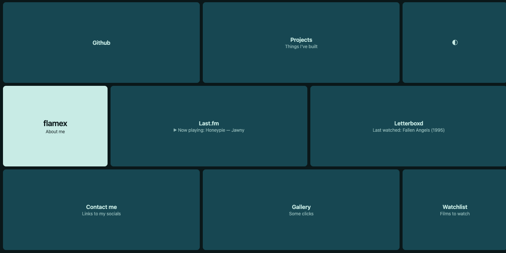
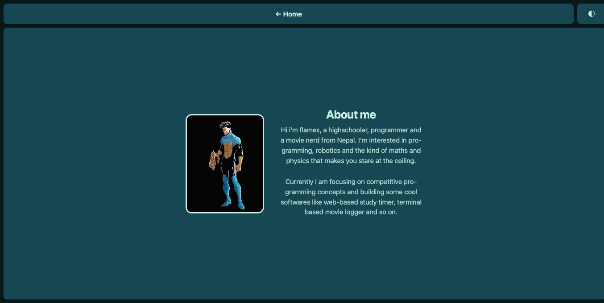
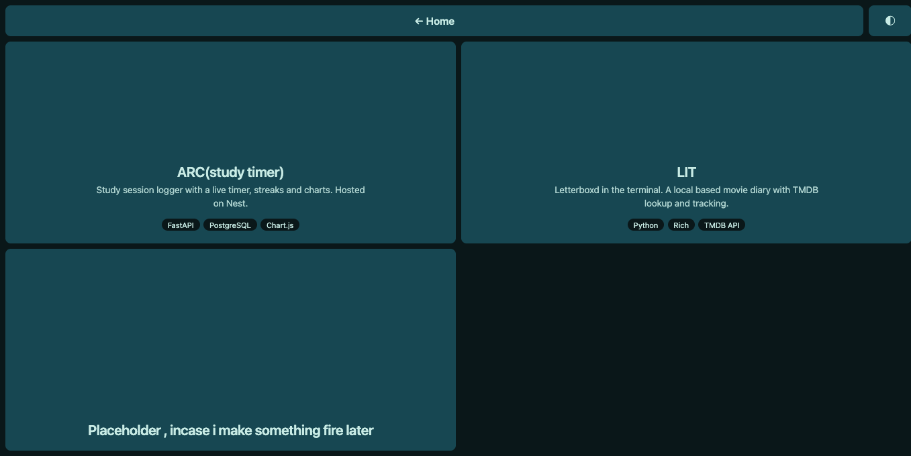
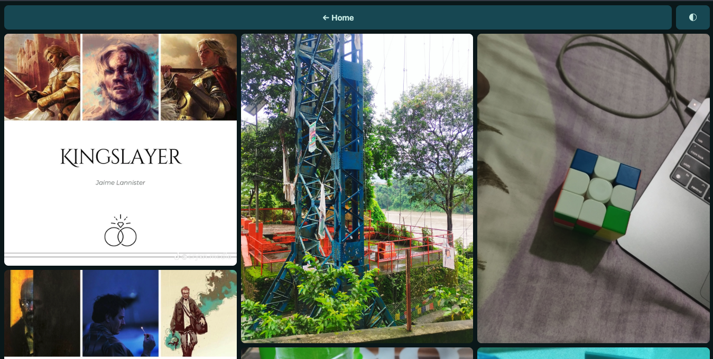
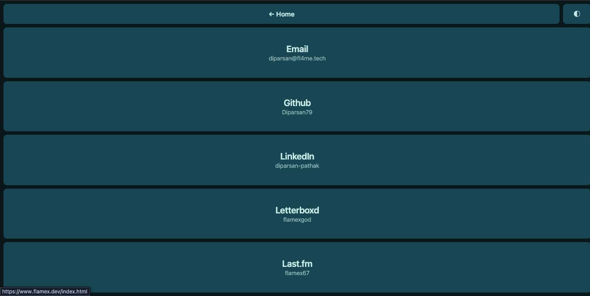
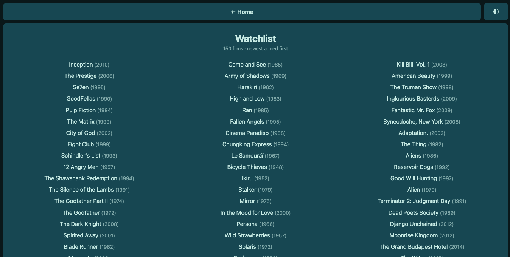

#flamex.dev

My personal site i made with html , css and js.

I've always made many ai-generated websites and mostly personal websites and nothing ever truly felt mine. This one was purely done by me with little help of ai so im really proud of this finished result.

The site contains the following features:
1. Home page

- cool grid-styled landing page. Love the looks honestly
- also features the live data of last listened / currently listening music and last watched movie in letterboxd ( more on that later)

2. About page

- just a photo and a few lines about me. 
- had so many things planned for this but couldn't implement rn due to my time commitment. (maybe a v2 of my site having everything i planned if embassy also gets a v2)

3. Projects page

- ARC, LIT , and thats it , but will add many more in the future.

4. Gallery page

- around 20 photos for now , thought of adding descriptions to the images aswell but still looks lowk fine with those edges

5. Contact page

- email , github linkedin and random shi
- will add some more socials link , if they're not tooo private

6. Watchlist page 

- my letterboxd watchlist export file , will be updated automatically through a small python script once i add a new ```watchlist.csv``` file and re-run the ```python``` script.
- currently has the names , years and letterboxd links to it


##LIVE DATA
last.fm api pulls the music im currently listening 
for letterboxd , i setup a github workflow that runs a python script that checks my letterboxd rss and gets the last movie details the github action updates a data.json file and it is loaded.
I initially added last listened music through the github actions aswell but it was too slow and i wanted accurate live data so i used direct api handling through ```script.js```

## run it locally
```
git clone https://github.com/Diparsan79/flamex.dev
cd flamex.dev
python3 -m http.server
```
then open `localhost:8000` and mostly everything should work maybe expect for the live data.

inspired from coding kitten's website [codingkitten.dev](https://codingkitten.dev/)
although i didn't look at the codebase at all.

## ai usage 
ai was used for mostly learning about new concepts and learning to implement them in my website. It gave me valuable suggestions to add to my website , of which i added somethings but not much. furthermore , i did some basic debugging through ai and it generated the script to update the watchlist page which made the process so much easier.